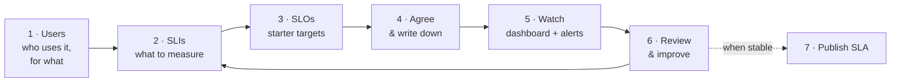

# SLO & SLA Framework

> **Status:** DRAFT v0.2 · **Owner:** Architecture · **Based on:** [Google SRE Workbook — Implementing SLOs](https://sre.google/workbook/implementing-slos/)

A simple, repeatable way for any team to say **how reliable its service should be**, **measure it**,
and **act on it**. It works for new services and for services already running.

🎤 **[View the stakeholder presentation](https://idan-maimon.github.io/sla-framework/presentation/)** — opens in the browser

## The whole framework on one page

| Step | Question it answers | Output |
|---|---|---|
| **1. Users** | Who uses the service and what do they do with it? | A short list of users and their key tasks |
| **2. SLIs** | What do we measure to know whether users are happy? | ≤ 5 SLIs, each written as `good events ÷ total events` |
| **3. SLOs** | What target is good enough? | A starter target per SLI, over a 4-week rolling window |
| **4. Agree** | Do owner, developers and operators all accept it, and what happens when we miss? | Signed **SLO document** + **error budget policy** |
| **5. Watch** | Are we on track right now? | Dashboard + error budget alerts |
| **6. Review** | Are the targets still right? | Monthly review at first, quarterly later |
| **7. SLA** | What do we promise consumers? | Short **SLA**, looser than the SLO, once the SLO has proven stable |

👉 Full step-by-step instructions: **[guide/2-the-steps.md](guide/2-the-steps.md)**

## Where do I start?

| Your service is… | Start at |
|---|---|
| **New** — not yet in production | Step 1, during design. Start measuring before go-live. |
| **Running, but has no SLOs** — monitoring and alerts only, "100% uptime" assumed | Step 1, using your existing metrics history |
| **Running, has an SLO/SLA nobody acts on** | Step 4 — agree an error budget policy, then review your SLIs in Step 6 |

## You're done when…

These four conditions come straight from the SRE Workbook:

- [ ] The SLOs are approved by everyone involved as **right for the users**.
- [ ] The people who run the service agree the SLOs **can be met under normal conditions**.
- [ ] Everyone has committed to **using the error budget to make decisions** — written down in an error budget policy.
- [ ] There is a **process for reviewing and improving** the SLOs.

## What's in this repo

| Folder | For | Read time |
|---|---|---|
| [`guide/1-the-basics.md`](guide/1-the-basics.md) | Everyone — SLI, SLO, error budget, SLA in plain words | 5 min |
| [`guide/2-the-steps.md`](guide/2-the-steps.md) | Team leads — the step-by-step guide | 15 min |
| [`guide/3-sli-menu.md`](guide/3-sli-menu.md) | Engineers — ready-made SLIs to pick from | 5 min |
| [`templates/`](templates/) | Copy these: SLO document, error budget policy, SLA | — |
| [`examples/vm-as-a-service-kubevirt/`](examples/vm-as-a-service-kubevirt/) | A filled-in example | 10 min |
| [`for-managers.md`](for-managers.md) | Department manager — what this is, what to decide | 3 min |
| [`presentation/`](presentation/) | Stakeholder slides — **[open live](https://idan-maimon.github.io/sla-framework/presentation/)**, or open `index.html` locally (works offline) | 12 slides |
| [`reference/`](reference/) | Optional depth: availability math, decision matrix, links | — |
| [`ideas/`](ideas/) | Open questions and future ideas | — |
