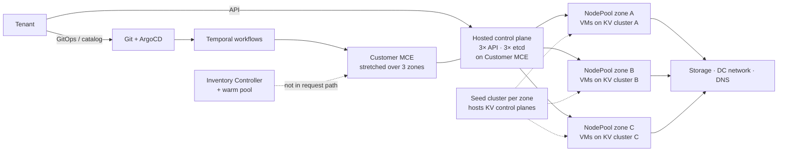

# SLO Document — Hosted OpenShift Clusters on KubeVirt (HCP + KubeVirt)

> Built with this framework. **New service.** No production data exists yet, so every
> target is a **starter value marked "ad hoc"**. They are replaced with measured values after the
> first 4 weeks of data (Step 2). Internal names are deliberately left out.

| | |
|---|---|
| **Status** | Draft |
| **Version** | 0.1 |
| **Authors** | Platform architect · `<platform service owner>` |
| **Reviewers** | `<dev lead>` · `<on-call lead>` |
| **Approver** | `<section leader>` |
| **Approval date** | — |
| **Revisit date** | 4 weeks after measurement goes live, then monthly for the first quarter |

## Service overview

The platform gives tenants **OpenShift clusters on demand**. Each tenant cluster is a HyperShift
**hosted cluster (HC)**: its control plane runs as pods on a shared management hub (Customer MCE),
and its workers are **KubeVirt VMs** drawn from a pre-built warm pool. Every tenant cluster spans
**three availability zones**, with one NodePool per zone, each on a separate KubeVirt (KV) cluster.
Tenants have read-only access and change their clusters through GitOps or the self-service catalog.

**Users:** tenant teams that run their workloads on hosted clusters.
*(The platform team and the OCP enablement team operate and support the service. They are not the users whose happiness these SLOs measure.)*

**Requirements:**

| ID | Requirement | What the user does |
|---|---|---|
| R1 | Provision | Request a new cluster and receive a working cluster |
| R2 | Modify | Add workers to a NodePool and get them Ready |
| R3 | Upgrade | Move control plane and workers to a new version without breaking workloads |
| R4 | Decommission | Delete the cluster and free its resources |

Between requirements, tenants also need the cluster to **stay available**: the cluster API answers
(deploy, GitOps sync, `oc get`) and worker nodes keep running. This is the **Availability** category
in the SLI table.

**Critical dependencies:**

| Dependency | Needed for | Owner | Has an SLO? |
|---|---|---|---|
| Customer MCE (hub) | S1 (hosts the control planes), R1/R2/R3 | Platform team | Not yet (internal) |
| KV clusters (one per zone) | S2, R2 | Platform team | Not yet (internal) |
| Seed cluster (one per zone) | KV control planes. Running VMs continue if it fails, but no scaling or upgrade in that zone. | Platform team | Not yet (internal) |
| Shared storage | S2 (live migration), etcd | Storage team | **Needed** |
| DC network | All | Network team | **Needed** |
| DNS | S1 (API endpoints), R1 (Redfish) | Network/DNS team | **Needed** |
| Identity provider | S1 login (soft: existing tokens keep working) | IAM team | **Needed** |
| Git + ArgoCD, Temporal | R1/R2/R3 (changes only, not runtime) | Platform team | Not yet (internal) |
| Warm pool / Inventory Controller | R1/R2 speed. By design it is never in the request path. | Platform team | Not yet (internal) |
| OCP release registry | R3 | External (Red Hat) | Public |

## SLIs and SLOs

Window: **4-week rolling** for S1 and S2. **Rolling quarter** for S3 to S5, because provisions,
scale-ups and upgrades are low-volume events and a 4-week ratio would swing on a single failure.

| ID | Category | SLI | Specification (plain words) | Implementation (how measured) | Starter SLO (ad hoc) |
|---|---|---|---|---|---|
| S1 | Availability | API uptime | Proportion of tenant API requests to the hosted cluster API that succeed | `apiserver_request_total` from each HCP's kube-apiserver (scraped on the Customer MCE): non-5xx ÷ all, excluding 429 throttling caused by the tenant. **Plus** a blackbox probe of `/readyz` on every HC API endpoint every 30 s, from outside the hub, so that DNS and network failures are counted too. | **99.9%** |
| S2 | Availability | Worker uptime | Proportion of worker-node-minutes in which a node that should be Ready is Ready | `kube_node_status_condition{condition="Ready",status="true"}` per HC, summed over node-minutes ÷ expected node-minutes. **Excluded:** a node drained by a NodePool roll the tenant scheduled (upgrade window, `maxUnavailable: 1`), and nodes being removed by a scale-down. | **99.5%** |
| S3 | R1 Provision | Speed | Proportion of valid provision requests where the HC is Available with all three NodePools at the requested size within the threshold | Request time from the catalog/Temporal create workflow; done time from `HostedCluster` condition `Available=True` plus all NodePools `ReadyReplicas == Replicas`. Excluded: quota or capacity rejection given to the tenant up front, and invalid specs. | **90% within 60 min · 99% within 120 min** |
| S4 | R2 Modify | Speed | Proportion of NodePool scale-up requests where the new nodes are Ready within the threshold | `update-nodepool` workflow start → NodePool `ReadyReplicas` reaching the new target. Each request counts once. Excluded: requests rejected up front by the pre-flight capacity check. | **95% within 30 min** |
| S5 | R3 Upgrade | Success | Proportion of upgrade runs (control plane, or one zone of a worker roll) that complete without manual intervention and without breaching S1 during the run | Upgrade workflow outcome + HostedCluster/NodePool version conditions. A run counts as bad if it needed a human step, ended in the DLQ, or S1 burned more than 2% of its budget during the run. | **95%** |

**Left out, for now:**

| Category | SLI | Why |
|---|---|---|
| R3 Upgrade | Duration | Five rows is the workbook's maximum; upgrade success matters more to tenants today. Candidate threshold: 90% of runs within 1.5 h. |
| R4 Decommission | Success | Low user pain. |
| Availability | API response time | E.g. 99% of non-watch requests < 1 s. Add once S1 is stable. |
| Availability | Live-migration transparency | No reliable measurement yet. |

### Canary cluster

Tenant provisions, scale-ups and upgrades are rare, so the platform runs **one canary hosted
cluster** of its own. Each day it scales a NodePool up and down, and each week it is recreated. It
runs every upgrade first. This gives S3 to S5 a steady flow of events and catches breakage before
tenants do. Canary events are reported separately and also included in the SLIs.

## Rationale

- **All targets are ad hoc. No production data exists yet.** Replace them with measured values,
  rounded down (Step 2), after 4 weeks of data (S1/S2) or one quarter (S3–S5). Lab benchmarks
  from the OpenShift benchmarking work, which serve quality goal SC2 (Predictability), are the
  first evidence for the S3/S4 thresholds.
- **S1 at 99.9%.** Each control plane runs 3 API servers and 3 etcd members across 3 zones
  (2-of-3 quorum), on a hub stretched across those zones. The design is meant to survive a full zone loss.
- **S2 at 99.5%, lower than S1.** A single worker sits in one zone, on one KV cluster, and
  depends on storage and network. Hypervisor maintenance uses live migration and should not count
  against it. A failed KV cluster or storage outage in a zone does count.
- **S3/S4 thresholds** assume the warm pool is not empty. Because the pool removes VM build
  time from the request path, an empty pool is a real user-facing failure and is counted.
- **Dependency check: incomplete.** Storage, network, DNS and identity do not publish SLOs yet.
  Assuming 99.9% each for the hard runtime dependencies, one zone's worker ceiling is about
  0.999 × 0.999 × (KV + own components), which is below 99.8%. That supports 99.5% for S2.
  **Caution (workbook):** three zones do not make S1 = 1 − (0.001)³. All zones share the hub,
  the network core, DNS, Git and the release process, so zone redundancy is not independent.

## Error budget

| ID | SLO | Window | Budget |
|---|---|---|---|
| S1 | 99.9% API uptime | 4 weeks | 0.1% of requests (≈ 40 min of full outage) |
| S2 | 99.5% worker uptime | 4 weeks | 0.5% of node-minutes (≈ 3 h 22 min per node) |
| S3 | 90% provisions within 60 min | Quarter | 10% of provisions |
| S3 | 99% provisions within 120 min | Quarter | 1% of provisions |
| S4 | 95% scale-ups within 30 min | Quarter | 5% of scale-ups |
| S5 | 95% upgrades without manual intervention | Quarter | 5% of upgrade runs |

Response to budget exhaustion: [error budget policy](error-budget-policy.md).

## Clarifications and caveats

- **Excluded from all SLIs:** canary-only test failures *if* they come from deliberate fault
  injection, load tests, requests the tenant caused (invalid manifests, quota), and workloads
  inside tenant clusters (the tenant's own apps).
- **Planned worker reboots** inside a tenant-chosen upgrade window are excluded from S2. Rolls
  forced by the version-skew deadline (workers may trail the control plane by at most two minors)
  are **not** excluded, because the platform decides their timing.
- **Seed cluster failure** stops scale and upgrade in one zone but not running workers. It shows up
  in S4/S5, not S2. That is intended.
- **Known measurement gaps:**
  - S3/S4 need the request timestamp recorded by the provision/scale workflow.
  - S2 needs worker-node metrics from every hosted cluster in central monitoring.
  - The "S1 budget burned during an upgrade" condition in S5 needs a recording rule that joins the upgrade run to the S1 burn.
- **Idea for later reviews:** per-tenant SLO tracking (the workbook's "bucketing" idea, i.e. how many tenants are inside SLO).

## Change log

| Version | Date | Change | Approved by |
|---|---|---|---|
| 0.1 | 2026-11-08 | First draft from the framework | — |
