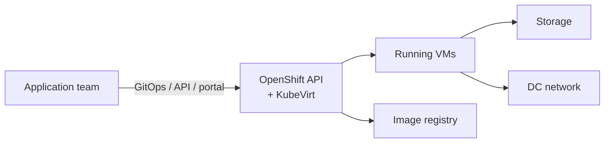

# SLO Document — VM-as-a-Service

> ILLUSTRATIVE EXAMPLE. Numbers and metric names are not real.

| | |
|---|---|
| **Status** | Approved |
| **Version** | 1.1 |
| **Authors** | Platform architect · Virtualization team tech lead (service owner) |
| **Reviewers** | Virtualization dev lead · On-call lead |
| **Approver** | Section leader |
| **Approval date** | 2027-02-01 |
| **Revisit date** | 2027-03-01 (monthly during the first quarter) |

## Service overview

VM-as-a-Service lets application teams create and run Linux and Windows virtual machines on the
shared OpenShift platform (OpenShift Virtualization / KubeVirt). Requests come through GitOps,
the API or the portal.

**Users:** application teams running production and test workloads in VMs.

**Requirements:**

| ID | Requirement | What the user does |
|---|---|---|
| R1 | Provision | Create a VM and log into it |
| R2 | Modify | Resize or restart a VM |
| R3 | Upgrade | VMs keep running while the platform is upgraded |
| R4 | Decommission | Delete a VM and free its resources |

**Critical dependencies:**

| Dependency | Needed for | Owner | Has an SLO? |
|---|---|---|---|
| OpenShift cluster | All | Platform team | 99.9% |
| Storage | S3 (running VMs), R1 | Storage team | 99.9% |
| DC network | All | Network team | 99.95% |
| Image registry | R1 only | Platform team | Not yet |

## SLIs and SLOs

4-week rolling window.

| ID | Category | SLI | Specification | Implementation | SLO |
|---|---|---|---|---|---|
| S1 | R1 Provision | Success | Proportion of valid VM create requests that reach *Running* | VMIs reaching Running ÷ all valid create requests (provisioning API counter). Quota denials and invalid specs excluded. | **99.5%** |
| S2 | R1 Provision | Speed | Proportion of valid VM create requests that reach *Running* within the threshold | VMIs reaching Running within N s (`kubevirt_vmi_phase_transition_time_from_creation_seconds_bucket{phase="Running"}`) ÷ all valid create requests (provisioning API counter). | **90% within 2.5 min** **99% within 5 min** |
| S3 | Availability | Uptime | Proportion of VM-minutes in which a VM that should be running is reachable | `sum(sum_over_time(probe_success{job="vm-probe"}[4w]))` ÷ `sum(count_over_time(probe_success{job="vm-probe"}[4w]))`. One probe per VM (guest agent / TCP 22) every minute. VMs stopped by the consumer are excluded. | **99.5%** |

**Left out, for now:**

| Category | SLI | Why |
|---|---|---|
| R2 Modify | Success, Speed | Resize/restart is less frequent and causes little user pain. Revisit at the Q2 review. |
| R3 Upgrade | Success | Platform upgrades use live migration; interruptions already show up in S3. |
| R4 Decommission | Success | Rarely hurts anyone. |
| Availability | Response time (disk I/O) | No reliable per-VM I/O metric yet. |

## Rationale

Measured over 4 weeks before go-live (synthetic probe plus pilot users), then rounded:

| ID | SLI | Measured | Starter SLO |
|---|---|---|---|
| S1 | Creates that reached Running | 99.71% (12,444 of 12,480) | 99.5% |
| S2 | Created within 5 min | 99.29% (12,391 of 12,480) | 99% |
| S2 | p90 create time | 2 min 10 s | 90% within 2.5 min |
| S3 | VM uptime | 99.71% | 99.5% |

**Dependency check:** OpenShift × storage × network = 0.999 × 0.999 × 0.9995 ≈ 99.75% at best,
so a 99.9% uptime SLO is not realistic without multi-cluster placement. That option is recorded as a
possible future aspirational SLO.

**Review note:** at approval, the on-call lead asked for 5 min rather than 3 min for the S2 tail
threshold, because large Windows images make first boots slow.

## Error budget

| ID | SLO | Budget (4 weeks) |
|---|---|---|
| S1 | 99.5% creates reach Running | 0.5% of creates (≈ 62 at current volume) |
| S2 | 99% created within 5 min | 1% of creates (≈ 125) |
| S2 | 90% created within 2.5 min | 10% of creates (≈ 1,250) |
| S3 | 99.5% uptime | 0.5% of VM-minutes (equivalent to 3 h 22 min of downtime for every VM) |

Response to budget exhaustion: [department default error budget policy](../../templates/error-budget-policy.md), no changes.

## Clarifications and caveats

- Excluded: quota denials, invalid VM specs, VMs stopped by their owner, load tests.
- Known gap: the KubeVirt metric only counts VMs that *eventually* start. The denominator in S1 and
  S2 uses the provisioning API's request counter so that creates which never start still count as bad.
- Live-migration interruptions are not measured separately yet. To be considered at the Q2 review.

## Change log

| Version | Date | Change | Approved by |
|---|---|---|---|
| 1.0 | 2027-01-04 | First version | Section leader |
| 1.1 | 2027-02-01 | Monthly review: image-registry outage used 40% of the S2 budget → image cache added. SLOs unchanged. | Section leader |
