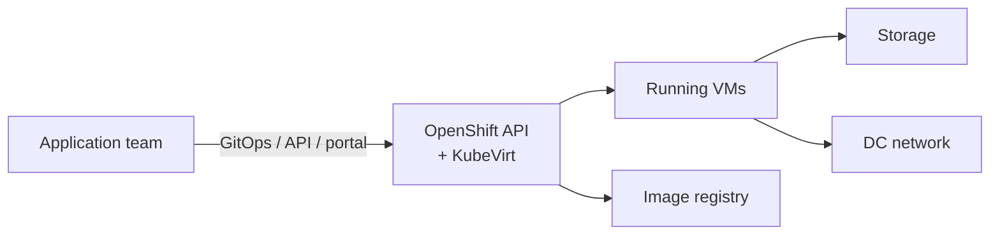

# SLO Document — VM-as-a-Service

> ILLUSTRATIVE EXAMPLE. Numbers and metric names are not real.

| | |
|---|---|
| **Status** | Approved |
| **Version** | 1.1 |
| **Authors** | Virtualization team tech lead |
| **Reviewers** | Architect; senior virtualization engineer |
| **Approvers** | Virtualization team manager (service owner) · Dev lead · On-call lead |
| **Approval date** | 2027-02-01 |
| **Next review** | 2027-03-01 (monthly during the first quarter) |
| **Path** | A (new service) |

## 1. Service overview

VM-as-a-Service lets application teams create and run Linux and Windows virtual machines on the
shared OpenShift platform (OpenShift Virtualization / KubeVirt). Requests come through GitOps,
the API or the portal.

**Users:** application teams running production and test workloads in VMs.

**Key tasks:**
1. Create a VM and log into it
2. My VM keeps running
3. Resize / restart a VM *(not covered by an SLO yet)*

**Critical dependencies:** OpenShift cluster (99.9%), storage (99.9%), DC network (99.95%), image registry (create only).

## 2. SLIs and SLOs

4-week rolling window.

| Task | SLI type | Specification | Implementation | SLO |
|---|---|---|---|---|
| Create a VM | Provisioning success + speed | Proportion of valid VM create requests that reach *Running* within the threshold | VMIs reaching Running within N s (`kubevirt_vmi_phase_transition_time_from_creation_seconds_bucket{phase="Running"}`) ÷ all valid create requests (provisioning API counter). Quota denials and invalid specs excluded. | **90% within 2.5 min** **99% within 5 min** |
| My VM keeps running | Running resource uptime | Proportion of VM-minutes in which a VM that should be running is reachable | `sum(sum_over_time(probe_success{job="vm-probe"}[4w]))` ÷ `sum(count_over_time(probe_success{job="vm-probe"}[4w]))`. One probe per VM (guest agent / TCP 22) every minute. VMs stopped by the consumer are excluded. | **99.5%** |

## 3. Rationale

Measured over 4 weeks before go-live (synthetic probe plus pilot users), then rounded:

| SLI | Measured | Starter SLO |
|---|---|---|
| Created within 5 min | 99.29% (12,391 of 12,480) | 99% |
| p90 create time | 2 min 10 s | 90% within 2.5 min |
| VM uptime | 99.71% | 99.5% |

**Dependency check:** OpenShift × storage × network = 0.999 × 0.999 × 0.9995 ≈ 99.75% at best,
so a 99.9% uptime SLO is not realistic without multi-cluster placement. That option is recorded as a
possible future aspirational SLO.

**Agreement note:** on-call asked for 5 min rather than 3 min for the tail threshold, because
large Windows images make first boots slow.

## 4. Error budget

| SLO | Budget (4 weeks) |
|---|---|
| 99% created within 5 min | 1% of creates (≈ 125 at current volume) |
| 90% created within 2.5 min | 10% of creates (≈ 1,250) |
| 99.5% uptime | 0.5% of VM-minutes (equivalent to 3 h 22 min of downtime for every VM) |

Response to budget exhaustion: [department default error budget policy](../../templates/error-budget-policy.md), no changes.

## 5. Clarifications and caveats

- Excluded: quota denials, invalid VM specs, VMs stopped by their owner, load tests.
- Known gap: the KubeVirt metric only counts VMs that *eventually* start. The denominator uses the
  provisioning API's request counter so that creates which never start still count as bad.
- Not yet covered: resize/restart (task 3) and live-migration interruptions. To be considered at the Q2 review.

## 6. Change log

| Version | Date | Change | Approved by |
|---|---|---|---|
| 1.0 | 2027-01-04 | First version | Service owner, dev lead, on-call lead |
| 1.1 | 2027-02-01 | Monthly review: image-registry outage used 40% of the provisioning budget → image cache added. SLOs unchanged. | Same |
